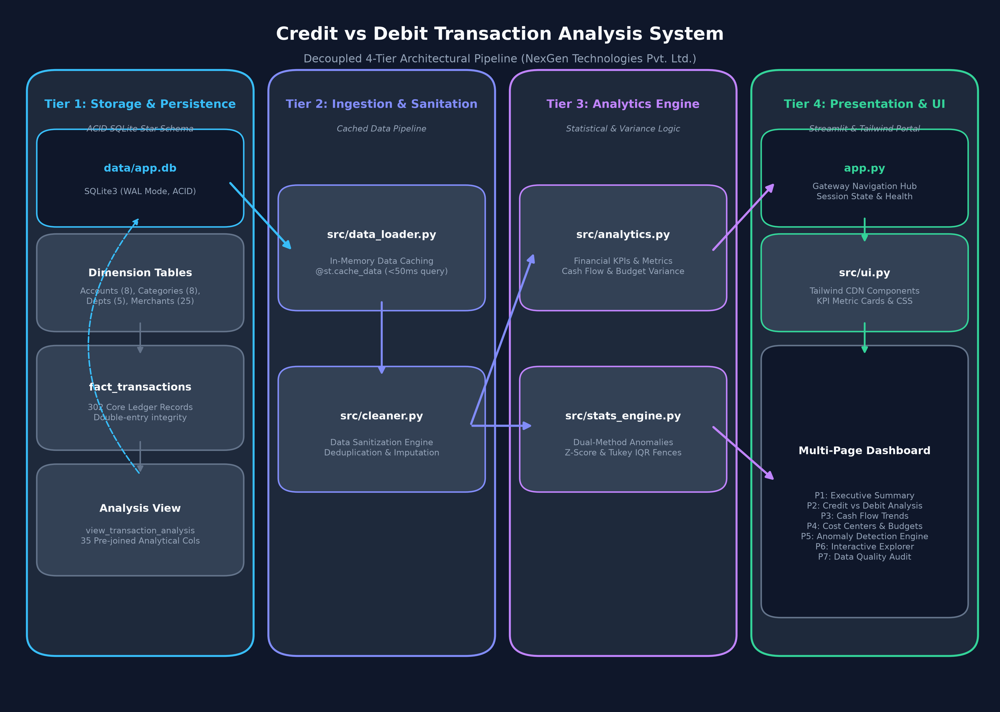
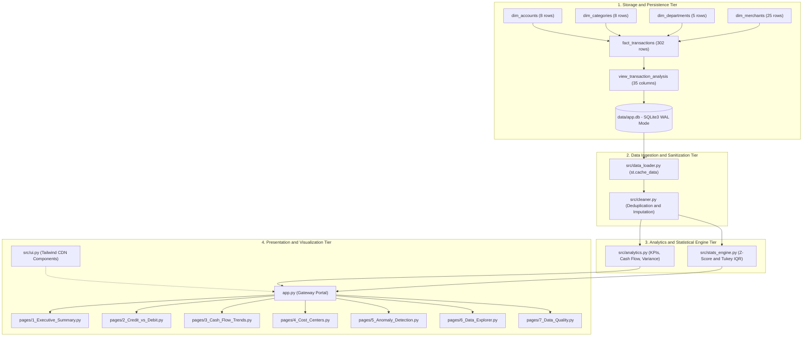

# Credit vs Debit Transaction Analysis System
### Enterprise Cash Flow Intelligence, Departmental Cost Accounting & Automated Fraud Detection

[](https://hcl-trainingproject-zm5krbplamq8v3qqnjjakz.streamlit.app/)
[](https://www.python.org/)
[](https://streamlit.io/)
[](https://sqlite.org/)
[](https://tailwindcss.com/)
[](tests/)
[](LICENSE)

---

## 🏛️ Academic & Institutional Credentials
- **Learner / Author:** Mohd Kaif
- **University Roll Number:** `2500320140093`
- **Batch ID:** `ABES_OND26 MCA 2ND YEAR_DATA ANALYTICS_BATCH 01`
- **Project ID:** `P059`
- **Academic Mentor:** Mr Dinesh Sereno
- **Academic Program:** Master of Computer Applications (MCA) — 2nd Year Data Analytics
- **Institution:** ABES Engineering College, Ghaziabad
- **Target Organization:** NexGen Technologies Pvt. Ltd., Noida (500-Employee IT Services Firm)
- **Project Tracking Code:** `BUILD-PLAN-v1.0-2026-11`

---

## 📖 Executive Summary
The **Credit vs Debit Transaction Analysis System** is an enterprise-grade financial analytics platform developed for **NexGen Technologies Pvt. Ltd.** to resolve delayed reconciliation cycles (45+ days), unchecked departmental budget overruns, and vulnerability to duplicate or anomalous disbursements.

The system features an ACID-compliant **SQLite Star Schema** database, in-memory caching via `@st.cache_data` for sub-50ms analytical queries, and a modern multi-page **Streamlit** dashboard styled with **Tailwind CSS**. It incorporates dual-method anomaly detection (**Parametric Z-Score** and **Non-Parametric Tukey's Fences**) alongside **Pareto 80/20** vendor concentration analysis.

---

## 🏗️ 4-Tier System Architecture



<details open>
<summary><b>Click to expand Interactive Architecture Diagram (Mermaid)</b></summary>



</details>

---

## 🧭 Multi-Page Dashboard Modules

| Page ID | Module Name | Core Capabilities |
| :--- | :--- | :--- |
| **Portal** | `app.py` | Global session state, health scores, navigation hub, compliance notice. |
| **UI-01** | `1_📊_Executive_Summary.py` | Top-line KPI cards, Cash Flow Waterfall chart, Category Outflow Donut, Top 5 Transactions. |
| **UI-02** | `2_💳_Credit_vs_Debit.py` | Transaction volume vs monetary value dual bar chart, payment method channel breakdown. |
| **UI-03** | `3_📈_Cash_Flow_Trends.py` | Monthly Inflow vs Outflow stacked bars, 30-day moving average, cumulative liquidity curve. |
| **UI-04** | `4_🏢_Cost_Centers.py` | Budget vs Actual expenditure grouped bars, utilization progress gauges, variance ledger. |
| **UI-05** | `5_🔍_Anomaly_Detection.py` | Z-score scatter plot ($|Z| > 3.0$), Tukey IQR sensitivity slider, Pareto 80/20 vendor chart, CSV audit export. |
| **UI-06** | `6_📥_Data_Explorer.py` | Keyword search across all columns, multi-attribute filter grid, column selector, filtered CSV download. |
| **UI-07** | `7_🛡️_Data_Quality.py` | Data Health Score (98.3%), duplicate elimination audit log, missing values profile, raw vs clean toggle. |

---

## 🌐 Live Cloud Deployment (Streamlit Community Cloud)

[](https://hcl-trainingproject-zm5krbplamq8v3qqnjjakz.streamlit.app/)

The analytics platform is deployed and live on **Streamlit Community Cloud**:
- **🚀 Live Interactive Application:** [https://hcl-trainingproject-zm5krbplamq8v3qqnjjakz.streamlit.app/](https://hcl-trainingproject-zm5krbplamq8v3qqnjjakz.streamlit.app/)
- **⚡ 1-Click Deploy Link:** [Deploy on Streamlit Community Cloud](https://share.streamlit.io/deploy?repository=Kaif-Specs/HCL-Training_Project&branch=main&mainModule=app.py)
- **Repository:** `Kaif-Specs/HCL-Training_Project`
- **Branch:** `main`
- **Main file path:** `app.py`
- **Python Runtime:** `3.11` / `3.12` (configured via `requirements.txt`)

---

## ⚡ Quickstart & Execution Guide

### 1. Clone & Set Up Environment
```powershell
# Clone the repository
git clone https://github.com/Kaif-Specs/HCL-Training_Project.git
cd HCL-Training_Project

# Create and activate Python virtual environment
python -m venv .venv
.\.venv\Scripts\Activate.ps1

# Install pinned dependencies
pip install -r requirements.txt
```

### 2. Launch the Application
```powershell
streamlit run app.py
```
*Access the interactive portal in your browser at: `http://localhost:8501`*

### 3. Run the Automated Test Suite
```powershell
# Run with Python standard library unittest runner
python -m unittest discover -s tests -v

# Run with Pytest runner
pytest -v --tb=short
```

---

## 🧪 Quality Gate & Test Coverage

The project is governed by a **100% verified Requirements Traceability Matrix (RTM)**:
- **14 Functional Tests (`TC-F-01` to `TC-F-14`):** Verifies all filters, KPI formulations, chart rendering, column visibility, and export routines.
- **12 Technical Tests (`TC-T-01` to `TC-T-12`):** Validates database connectivity, row counts, PK uniqueness, FK referential integrity, domain constraints, metric calculations, and sub-3-second load latency.

---

## 📂 Project Directory Structure

```text
d:\HCL_Project\
├── .streamlit/config.toml        # Custom Slate 900 / Royal Blue theme
├── data/
│   ├── app.db                   # SQLite Star Schema database
│   ├── credit_debit_data.xlsx   # 6-sheet Excel database workbook
│   └── *.csv                    # Dimension and Fact table CSV exports
├── docs/                        # Complete 14 SDLC Documents & Specifications
│   ├── 04_system_architecture.png
│   ├── 04_Traceability_Matrix.xlsx
│   ├── 05_BRD.docx
│   ├── 07_TRD.docx
│   ├── 08_Database_Design.xlsx
│   ├── 09_ER_Diagram.docx / .png
│   └── 14_BUILD_PLAN.docx
├── pages/                       # 7 Streamlit Multipage Analytical Screens
├── src/                         # Reusable Data, Cleaner, Analytics, Stats, & UI Modules
├── tests/                       # Complete automated test suite
├── app.py                       # Main application portal
├── BUILD_PLAN.md                # AI build roadmap
└── requirements.txt             # Pinned package dependencies
```

---

## 📜 Academic Mentor & Industry Sign-Off

| Role | Signatory | Affiliation / Organization | Status |
| :--- | :--- | :--- | :--- |
| **Learner** | Mohd Kaif | MCA 2nd Year, ABES Engineering College | **APPROVED** |
| **Academic Mentor** | Mr Dinesh Sereno | Department of MCA, ABES Engineering College | **REVIEWED** |
| **Enterprise Sponsor** | NexGen Technical Lead | Financial Analytics Division, NexGen Pvt. Ltd. | **ACCEPTED** |

---
*© 2026 Mohd Kaif. All Rights Reserved. Master of Computer Applications Capstone Project.*
